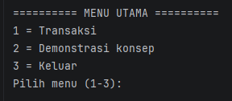
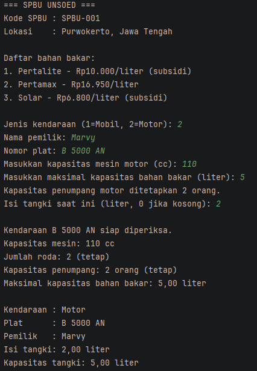
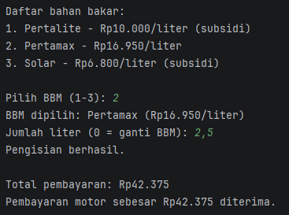
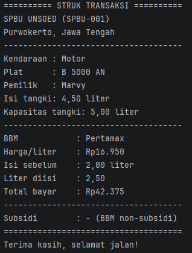
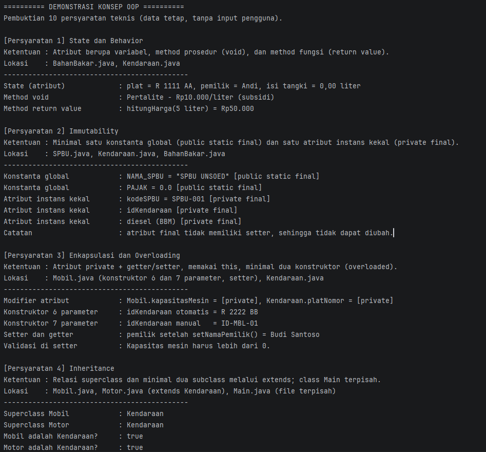
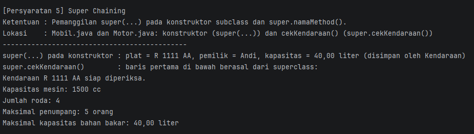
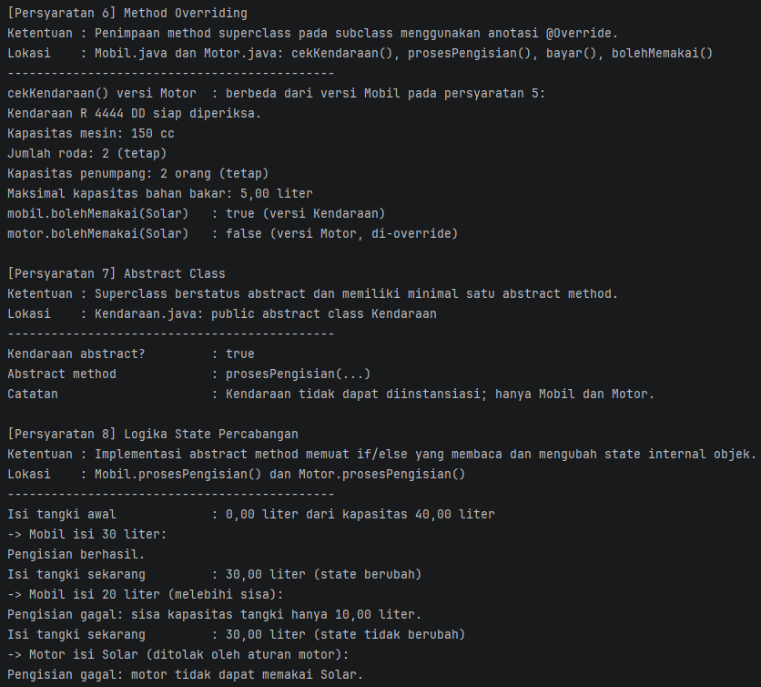
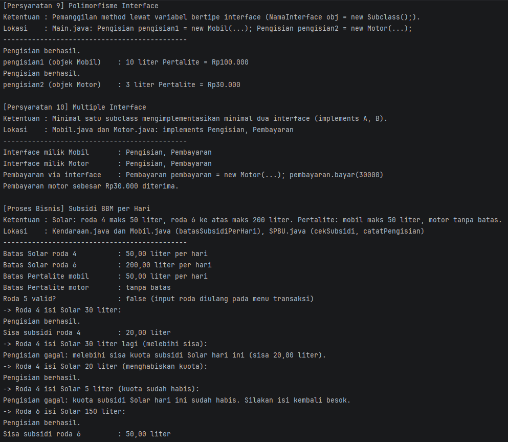
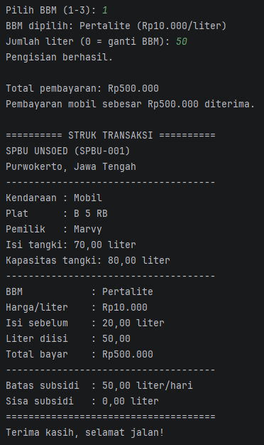
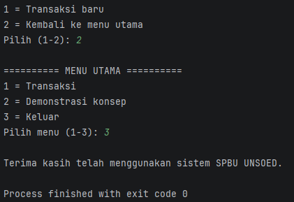

# Sistem SPBU - Responsi Akhir Praktikum PBO Sem 3

## 1. Identitas

| | |
|---|---|
| Nama | Dwi Marvian |
| NIM | H1D025063 |
| Tema | **SPBU** (digit terakhir 3) |
| Mata kuliah | Praktikum Pemrograman Berorientasi Objek |
| Institusi | Jurusan Informatika, Fakultas Teknik, Universitas Jenderal Soedirman |

---

## 2. Deskripsi Program

Simulasi transaksi pengisian bahan bakar di SPBU berbasis terminal (Java). Program memiliki dua fitur utama yang dipilih dari **Menu Utama**:

| Menu | Fungsi |
|---|---|
| **1 = Transaksi** | Simulasi pengisian BBM untuk Mobil atau Motor, dari input data sampai struk. |
| **2 = Demonstrasi konsep** | Pembuktian otomatis 10 persyaratan teknis tugas (tanpa input pengguna). |
| **3 = Keluar** | Menutup program. |

### Alur Menu

```
MENU UTAMA ──1──> TRANSAKSI ──selesai──> 1 = Transaksi baru ─┐
     ▲   │                                2 = Kembali ke menu │
     │   │                                      │             │
     │   └──2──> DEMONSTRASI ──selesai──> 1 = Kembali ke menu │
     │                                    2 = Ulangi demo     │
     └──────────────────────────────────────┘                 │
     └──3──> KELUAR                         (ulang transaksi) ┘
```

### Alur Transaksi (6 langkah)

1. Data awal SPBU dan daftar bahan bakar yang tersedia
2. Input data kendaraan (jenis, pemilik, plat, spesifikasi, **jumlah roda untuk mobil**, kapasitas tangki, dan isi tangki saat ini). Jika isi tangki sama dengan kapasitas, program menampilkan pesan **tangki penuh** dan transaksi langsung dihentikan
3. Data kendaraan ditampilkan
4. Daftar bahan bakar ditampilkan kembali
5. Memilih BBM dan mengisi jumlah liter (masukkan 0 pada jumlah liter untuk mengganti BBM). Urutan pengecekan: **kuota subsidi dulu, baru kapasitas tangki**; jika tidak sesuai, jumlah liter diulang
6. Struk transaksi (termasuk batas dan sisa subsidi hari ini)

---

## 3. Cara Compile dan Run

Pastikan **Java JDK** sudah terpasang (`javac -version`).

**Gunakan compiler IDE seperti IntelliJ IDEA, Eclipse, atau VS Code untuk compile dan run langsung.**

Atau lewat terminal. Semua file memakai `package Proyek_SPBU_Responsi_PBO;`, sehingga compile dan run dilakukan dari **folder induk** (satu tingkat di atas folder `Proyek_SPBU_Responsi_PBO`):

```bash
javac Proyek_SPBU_Responsi_PBO/*.java
java Proyek_SPBU_Responsi_PBO.Main
```

---

## 4. Struktur File dan Class

| File | Jenis | Peran |
|---|---|---|
| `Main.java` | Class utama | Menu, alur transaksi, dan demonstrasi konsep. Dipisah dari class lain. |
| `SPBU.java` | Class | Data SPBU (nama, kode, lokasi). |
| `BahanBakar.java` | Class | Data bahan bakar (nama, harga per liter, jenis diesel). |
| `Kendaraan.java` | **Abstract class** | Superclass: atribut dan perilaku umum kendaraan. |
| `Mobil.java` | Subclass | Turunan `Kendaraan`; `implements Pengisian, Pembayaran`. |
| `Motor.java` | Subclass | Turunan `Kendaraan`; `implements Pengisian, Pembayaran`. |
| `Pengisian.java` | Interface | Kontrak proses pengisian BBM. |
| `Pembayaran.java` | Interface | Kontrak pembayaran. |

### Diagram Class

```
            <<interface>>          <<interface>>
             Pengisian              Pembayaran
                 ▲  ▲                 ▲  ▲
                 :  :                 :  :        (implements)
     ┌───────────:──:─────────────────:──:───────────┐
     │           :  :                 :  :           │
   Mobil ────────┘  └──── Motor ──────┘  └───────────┘
     │ extends             │ extends
     └──────────┬──────────┘
          <<abstract>>
           Kendaraan
   (abstract prosesPengisian)

   SPBU          BahanBakar        (class pendukung)
```

---

## 5. Dasar Teori Singkat

### Class dan Objek
- **Class** adalah *cetak biru* yang mendefinisikan atribut (data) dan method (perilaku).
- **Objek** adalah *wujud nyata* (instance) dari class, dibuat dengan `new`.
- Contoh: `Mobil` adalah class; `new Mobil("R 1111 AA", "Andi", 1500, 4, 5, 40)` adalah sebuah objek.

### Empat Pilar OOP

| Pilar | Arti | Penerapan di program |
|---|---|---|
| **Enkapsulasi** | Menyembunyikan data (`private`) dan hanya membukanya lewat getter/setter yang bisa memvalidasi. | Semua atribut `private`. `setKapasitasMesin(0)` ditolak dengan exception. |
| **Inheritance (Pewarisan)** | Subclass mewarisi atribut dan method superclass. | `Mobil` dan `Motor` `extends Kendaraan`, sehingga tidak menulis ulang plat, pemilik, dan totalLiter. |
| **Polimorfisme** | Satu pemanggilan method, perilaku berbeda sesuai objek aslinya. | `Pengisian p = mobil/motor; p.prosesPengisian(...)` memberi hasil berbeda untuk tiap objek. |
| **Abstraksi** | Menyembunyikan detail dan hanya menampilkan kontrak. | `Kendaraan` (abstract class) dan interface `Pengisian`/`Pembayaran`. |

---

## 6. Pemetaan 10 Persyaratan Teknis

Semua persyaratan di bawah dapat dibuktikan langsung lewat **Menu 2 (Demonstrasi konsep)**. Setiap bagian demonstrasi menampilkan nomor persyaratan, ketentuan dari lembar tugas, lokasi kode, dan hasil eksekusi.

| No | Konsep | Lokasi di kode | Penjelasan |
|---|---|---|---|
| 1 | State dan Behavior | `Kendaraan`, `BahanBakar` | **State**: atribut seperti `totalLiter`, `hargaPerLiter`. **Method void**: `tampilkanInfo()`, `cekKendaraan()`. **Method return value**: `hitungHarga()`, `prosesPengisian()`, `getSisaKapasitas()`. |
| 2 | Immutability | `SPBU`, `Kendaraan`, `BahanBakar` | **Konstanta global**: `SPBU.NAMA_SPBU` dan `SPBU.PAJAK` (`public static final`). **Atribut kekal**: `SPBU.kodeSPBU`, `Kendaraan.idKendaraan`, `BahanBakar.diesel`, `BahanBakar.bersubsidi` (`private final`, tanpa setter). |
| 3 | Enkapsulasi dan Overloading | Semua class | Semua atribut `private` dengan getter/setter; `this` dipakai pada konstruktor dan setter; konstruktor overload pada `BahanBakar` (2 dan 4 parameter), `Kendaraan`, `Mobil` (6 dan 7 parameter), `Motor` (4 dan 5 parameter). |
| 4 | Inheritance | `Mobil`, `Motor` | `Mobil extends Kendaraan`, `Motor extends Kendaraan`. `Main` berada di file terpisah. |
| 5 | Super Chaining | `Mobil`, `Motor` | `super(platNomor, namaPemilik, idKendaraan, kapasitas)` pada konstruktor; `super.cekKendaraan()` pada `Mobil` dan `Motor`, `super.bolehMemakai()` pada `Motor`, serta `super.batasSubsidiPerHari()` pada `Mobil`. |
| 6 | Method Overriding | `Mobil`, `Motor` | `@Override` pada `cekKendaraan()`, `prosesPengisian()`, `bayar()`, `Motor.bolehMemakai()`, `Motor.getAlasanPenolakan()`, dan `Mobil.batasSubsidiPerHari()`. |
| 7 | Abstract Class | `Kendaraan` | `public abstract class Kendaraan` dengan abstract method `prosesPengisian(BahanBakar, double)`. |
| 8 | Logika State Percabangan | `Mobil.prosesPengisian`, `Motor.prosesPengisian` | Implementasi abstract method memakai `if/else` yang **membaca** `totalLiter` dan kapasitas tangki, lalu **mengubah** `totalLiter` jika pengisian berhasil. |
| 9 | Polimorfisme Interface | `Main` | `Pengisian pengisian1 = new Mobil(...);` dan `Pengisian pengisian2 = new Motor(...);` lalu `prosesPengisian(...)` dipanggil lewat variabel interface. |
| 10 | Multiple Interface | `Mobil`, `Motor` | `class Mobil extends Kendaraan implements Pengisian, Pembayaran`; hal yang sama untuk `Motor`. |

### Potongan Kode Penting

**Abstract class dan abstract method (poin 7)**
```java
public abstract class Kendaraan {
    public abstract double prosesPengisian(BahanBakar bahanBakar, double liter);
}
```

**Multiple interface dan overriding (poin 6, 10)**
```java
public class Mobil extends Kendaraan implements Pengisian, Pembayaran {
    @Override
    public double prosesPengisian(BahanBakar bahanBakar, double liter) { ... }
    @Override
    public boolean bayar(double jumlah) { ... }
}
```

**Logika if/else yang membaca dan mengubah state (poin 8)**
```java
if (getTotalLiter() + liter > getMaksimalKapasitasBahanBakar()) {   // baca state
    System.out.printf("Pengisian gagal: sisa kapasitas tangki hanya %.2f liter.%n", getSisaKapasitas());
    return 0;
} else {
    setTotalLiter(getTotalLiter() + liter);                         // ubah state
    return bahanBakar.hitungHarga(liter);
}
```

**Super chaining (poin 5)**
```java
public Mobil(String platNomor, String namaPemilik, String idKendaraan, int kapasitasMesin,
             int jumlahRoda, int maksimalPenumpang, double maksimalKapasitasBahanBakar) {
    super(platNomor, namaPemilik, idKendaraan, maksimalKapasitasBahanBakar);
    ...
}
@Override
public void cekKendaraan() {
    super.cekKendaraan();
    ...
}
```

---

## 7. Aturan Bisnis

- Daftar BBM: Pertalite (Rp10.000/liter), Pertamax (Rp16.950/liter), Solar (Rp6.800/liter).
- **Jumlah roda** diinput untuk mobil (valid: 4, atau 6 ke atas; input lain diulang). Motor tetap 2 roda.
- **Subsidi per hari** (dihitung per plat nomor dan jenis BBM):

  | BBM | Mobil roda 4 | Mobil roda 6 ke atas | Motor |
  |---|---|---|---|
  | Solar (subsidi) | maks 50 liter | maks 200 liter | tidak boleh memakai Solar |
  | Pertalite (subsidi) | maks 50 liter | maks 50 liter (sama rata) | tanpa batas |
  | Pertamax | tanpa batas | tanpa batas | tanpa batas |

  - Saat jumlah liter dimasukkan, **subsidi dicek lebih dulu**, baru kapasitas tangki. Jika melebihi sisa kuota, program menampilkan sisa kuota dan meminta jumlah liter diulang.
  - Jika kuota sudah habis, program menampilkan pesan untuk mengisi kembali besok; pengguna dapat memasukkan `0` untuk mengganti BBM.
  - Batas dan sisa subsidi ditampilkan pada struk transaksi.
  - Pemakaian dicatat di `SPBU` (spasi dan huruf besar/kecil pada plat diabaikan) dan hanya disimpan di memori selama program berjalan. Ini simulasi, jadi tidak ada pergantian hari otomatis.
- Isi tangki saat ini diinput pengguna (0 sampai kapasitas tangki); nilai ini menjadi state awal kendaraan.
- Jika isi tangki sama dengan kapasitas tangki, program menampilkan pesan tangki penuh dan transaksi langsung berhenti (kembali ke pilihan transaksi baru atau menu utama).
- Pengisian ditolak jika data tidak valid atau jumlah liter melebihi sisa kapasitas tangki (kapasitas dikurangi isi saat ini).
- **Motor tidak dapat memakai Solar.** Penolakan terjadi langsung saat memilih BBM (lewat `Kendaraan.bolehMemakai()` yang di-override pada `Motor`), dan dicek lagi di `Motor.prosesPengisian()`.
- Kapasitas penumpang motor tetap 2 orang.
- Input yang salah (huruf, kosong, nol, negatif) diulang tanpa membuat program berhenti.

---

## 8. Screenshot Luaran Program

### 8.1 Menu Utama


### 8.2 Transaksi: Data SPBU, Daftar BBM, dan Input Kendaraan


### 8.3 Transaksi: Pilih BBM dan Jumlah Liter


### 8.4 Transaksi: Struk


### 8.5 Demonstrasi Konsep



### 8.6 Demonstrasi Konsep



### 8.7 Mekanisme Subsidi


### 8.8 Pilihan Transaksi baru, Menu Utama, dan Keluar


---
